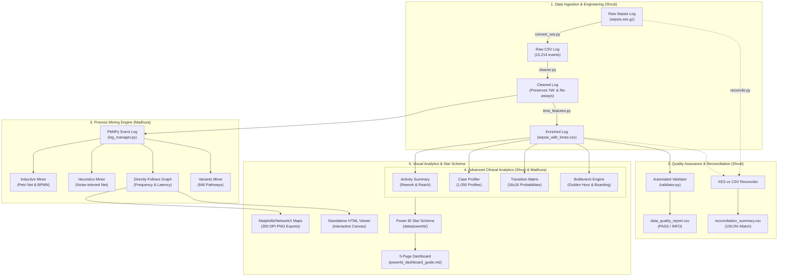

# CareFlow: Clinical Process Intelligence — Patient Journey Analysis Using Process Mining and Clinical Analytics

[](https://www.python.org/)
[](https://pm4py.fit.fraunhofer.de/)
[](https://powerbi.microsoft.com/)
[-brightgreen.svg)]()
[-success.svg)]()
[-blueviolet.svg)]()

> **Domain:** Healthcare Operations, Clinical Informatics & Process Intelligence  
> **Dataset:** Sepsis Cases Event Log (TU/e BPI Challenge / Acute Care Hospital Cohort)  
> **Repository:** `CareFlow-Clinical-Process-Intelligence`  
> **GitHub:** `https://github.com/shrutimali25/CareFlow-Clinical-Process-Intelligence`  
> **Team:** Shruti (Member 1 - Data Engineering & Clinical Analytics) & Madhura (Member 2 - Process Mining & Visual Analytics)  
> **Branches:** `main` (Production Baseline) | `shruti` (Data Engineering) | `madhura` (Process Mining)  
> **Workload Allocation Guide:** [`docs/team_work_allocation.md`](docs/team_work_allocation.md)  

---

## 📌 1. Project Overview & Clinical Problem Statement

Hospital administrators and clinical directors frequently encounter challenges in understanding why emergency department wait times are high, where patient handoffs stall, and how actual treatment pathways deviate from clinical guidelines. Traditional hospital business intelligence dashboards display aggregated, cross-sectional metrics—such as **Average Length of Stay (ALOS)** or **Monthly Bed Occupancy**—which act as a black box: they indicate *how long* a patient remained in hospital, but cannot reveal the *chaotic, real-world sequence of clinical activities* patients actually underwent.

**CareFlow** applies **Process Mining** algorithms to electronic health record (EHR) event logs. By extracting timestamped transaction histories, CareFlow:
1. Reconstructs the objective, end-to-end patient journey from initial emergency arrival to final discharge.
2. Formally discovers mathematical workflow models (**Petri Nets**, **BPMN**, and **Directly-Follows Graphs**).
3. Quantifies diagnostic rework loops and clinical transition probabilities ($16 \times 16$ transition matrix).
4. Evaluates clinical compliance against the international **Surviving Sepsis Campaign Golden Hour** targets.
5. Deploys an enterprise **Star-Schema** data model for interactive reporting in Microsoft Power BI.

---

## 🏗️ 2. System Architecture



---

## 📊 3. Verified Dataset Statistics

CareFlow uses the benchmark **Sepsis Cases Event Log** from an acute care hospital in the Netherlands. Every statistic has been empirically verified through automated regression suites:

| Dimension | Verified Dataset Value | Reconciliation Verification |
| :--- | :---: | :--- |
| **Total Recorded Events** | **15,214** | Exact 100.0% match with raw IEEE 1849 XES XML stream |
| **Unique Patient Encounters** | **1,050** | Validated across all fact and dimension tables |
| **Clinical Activities** | **16** | Spanning Intake, Diagnostics, Treatments, Wards, and Disposition |
| **Within-Case Transitions** | **14,164** | Formally satisfies $\sum_{i=1}^{1,050} (N_i - 1) = 15,214 - 1,050$ |
| **Unique Process Variants** | **846** | Demonstrates high clinical pathway variability |
| **Discrepancy / Lost Records** | **0** | Zero missing events, zero extra events ($100.0\%$ match) |

### The Critical Case "NA" Resolution
In Python Pandas, `pd.read_csv()` by default converts the string `"NA"` into a missing value (`NaN`). In this clinical dataset, `"NA"` is a valid pseudonymized patient identifier containing **24 events**. Previous analyses reporting 15,189 events and 1,049 cases lost patient `"NA"` and an additional duplicate blood test in case `"ES"` ($15,189 + 24 + 1 = 15,214$). CareFlow resolves this via `src/data/loader.py` with `keep_default_na=False, na_values=[""]` and explicit string typing, fully preserving all 24 events.

---

## 💻 4. Technology Stack

- **Language:** Python 3.10+ (Tested through Python 3.15 64-bit on Windows).
- **Process Mining Framework:** PM4Py (Process Mining for Python) v2.7.
- **Data Engineering & Manipulation:** Pandas 2.0+, NumPy 1.24+.
- **Process Visualization:** NetworkX 3.0+, Matplotlib 3.7+ (pure Python rendering—zero external Graphviz system dependencies required), HTML5 Canvas/SVG.
- **Business Intelligence & Reporting:** Microsoft Power BI Desktop (Star-Schema Relational Model & DAX).
- **Testing & Quality Assurance:** Python `unittest` framework (31 automated test cases).

---

## 📁 5. Repository Folder Structure

```text
CareFlow/
├── .gitignore                              # Git exclusion rules
├── README.md                               # Project documentation
├── requirements.txt                        # Python dependencies
├── run_pipeline.py                         # One-click master pipeline runner
├── data/
│   ├── raw/                                # Original raw XES dataset (sepsis.xes.gz)
│   ├── processed/                          # Cleaned, standardized, and enriched CSVs
│   │   ├── sepsis_event_log.csv            # 15,214 events
│   │   ├── sepsis_cleaned.csv              # Cleaned events (preserves 'NA' & repeat assays)
│   │   ├── sepsis_with_times.csv           # Enriched with elapsed minutes & sequence order
│   │   ├── patient_case_summary.csv        # 1,050 cases
│   │   ├── activity_frequency.csv          # 16 activities
│   │   └── activity_time_differences.csv   # 115 transitions
│   └── powerbi/                            # Star-Schema tables for Power BI
│       ├── fact_event_log.csv              # 15,214 rows
│       ├── dim_patient_cases.csv           # 1,050 rows
│       ├── dim_activities.csv              # 16 rows
│       ├── fact_transitions.csv           # 115 rows
│       ├── dim_variants.csv                # 846 rows
│       ├── fact_bottlenecks.csv            # 1,050 rows
│       └── dim_data_quality.csv            # 10 rows
├── docs/                                   # Complete technical documentation suite
│   ├── project_architecture.md             # System architecture & component flows
│   ├── data_dictionary.md                  # Schema definitions & column dictionary
│   ├── methodology.md                      # Process mining algorithms & mathematical models
│   ├── execution_guide.md                  # Setup & execution instructions
│   ├── testing_report.md                   # Complete test execution report
│   ├── team_contributions.md               # Honest division of roles & code ownership
│   ├── presentation_guide.md               # Slide-by-slide script for college viva & demo
│   ├── interview_questions.md              # 25 in-depth technical interview Q&A
│   └── archive/                            # Archived legacy templates
├── outputs/                                # Generated analytical outputs
│   ├── figures/                            # 300 DPI process maps & charts
│   │   ├── dfg_frequency_process_map.png   # Frequency-weighted clinical process map
│   │   ├── dfg_performance_bottleneck_map.png # Latency-annotated bottleneck map
│   │   ├── top_variants_distribution.png   # Top 15 variants Pareto distribution chart
│   │   └── careflow_interactive_process_map.html # Standalone offline HTML5 interactive map
│   ├── models/                             # Discovered formal process models
│   │   ├── inductive_petri_net.pnml        # Sound Inductive Petri Net (XML)
│   │   ├── inductive_bpmn.bpmn             # Standard BPMN 2.0 XML model
│   │   └── heuristics_petri_net.pnml       # Noise-tolerant Heuristics Petri Net
│   └── tables/                             # Analytical CSV summaries & matrices
│       ├── activity_frequency_detailed.csv # Rework rates, reach %, and repetition metrics
│       ├── activity_transition_matrix.csv  # 16x16 conditional transition probability matrix
│       ├── activity_transitions_detailed.csv # Transition IQR, std, and waiting hours
│       ├── admission_latency_analysis.csv  # ER-to-ward boarding times
│       ├── clinical_bottlenecks_summary.csv # Governance rules & stay-span distinctions
│       ├── dfg_frequency_table.csv         # 115 transition counts
│       ├── dfg_performance_table.csv       # 115 transition latency metrics
│       ├── heuristics_dependency_matrix.csv# 16x16 causal dependency matrix
│       ├── patient_case_profiles.csv       # 1,050 patient profiles with clinical flags
│       ├── process_variants_summary.csv    # 846 pathway variants with Pareto coverage
│       └── triage_to_antibiotics_analysis.csv # Sepsis Golden Hour timing analysis
├── reports/                                # Automated validation & audit reports
│   ├── data_quality_report.csv             # 14 reported metric rows
│   ├── final_data_validation_report.csv    # Formal PASS/INFO checklist
│   ├── reconciliation_summary.csv          # 100.0% XES vs CSV reconciliation proof
│   └── powerbi_dashboard_guide.md          # 5-page Power BI dashboard guide & DAX catalog
├── src/                                    # Modular source code
│   ├── data/                               # Data engineering modules (Shruti)
│   ├── validation/                         # Validation & reconciliation modules (Shruti)
│   ├── process_mining/                     # PM4Py discovery engine (Madhura)
│   ├── analysis/                           # Advanced clinical analytics (Shruti & Madhura)
│   └── visualization/                      # Pure Python visualizers (Madhura)
└── tests/                                  # Automated regression test suite
    ├── run_all_tests.py                    # Master test runner (executes all 31 tests)
    ├── test_data_pipeline.py               # 5 pipeline unit tests
    ├── test_process_mining.py              # 6 process mining discovery tests
    ├── test_advanced_analysis.py           # 7 advanced analysis tests
    ├── test_powerbi_exports.py             # 7 Power BI Star-Schema tests
    └── test_end_to_end.py                  # 6 end-to-end integration tests
```

---

## ⚙️ 6. Installation & Execution

### Prerequisites
- Python 3.10+ installed.
- 8 GB RAM laptop (CareFlow consumes $< 35\text{ MB}$ peak RAM).

### Quick Start
```powershell
# 1. Navigate to project directory
cd D:\Projects\CareFlow-Clinical-Process-Intelligence

# 2. Create and activate virtual environment
python -m venv .venv
.venv\Scripts\Activate.ps1

# 3. Install lightweight dependencies
pip install -r requirements.txt

# 4. Run the complete pipeline (Decompression -> Cleaning -> Mining -> Power BI)
python run_pipeline.py

# 5. Run the entire automated test suite
python tests/run_all_tests.py
```

### Individual Module Execution
```powershell
# Data Engineering
python src/Clean_data.py
python src/calculate_times.py
python src/reconcile_xes_csv.py

# Process Mining & Visualizations
python src/process_mining/run_process_mining.py

# Advanced Analytics
python src/activity_analysis.py
python src/case_summary.py
python src/time_difference_analysis.py
python src/analysis/bottleneck_analysis.py

# Power BI Star-Schema Preparation
python src/prepare_powerbi_data.py
```

---

## 🔬 7. Process Mining Discoveries & Clinical Insights

### A. Formal Process Models Discovered
1. **Inductive Miner Petri Net (`inductive_petri_net.pnml`):** Exported a workflow net comprising **39 places** and **50 transitions** (16 visible clinical activities, 34 silent $\tau$ routing transitions). Formal soundness and deadlock-freedom have not yet been independently validated.
2. **Inductive Miner BPMN (`inductive_bpmn.bpmn`):** Exported a standard BPMN 2.0 diagram featuring **62 nodes** and **89 sequence flows** using automated headless XML layout.
3. **Heuristics Miner Petri Net (`heuristics_petri_net.pnml`):** Discovered a noise-tolerant net comprising **33 places** and **74 transitions** capturing the primary care backbone, alongside an activity dependency matrix.

### B. Activity Workload & Laboratory Rework Rates
- **Top Activity by Volume:** `Leucocytes` (**3,383 occurrences**, 96.4% patient reach).
- **Highest Laboratory Rework:** `CRP` (**68.72%** of reached cases underwent serial repeated draws; max 21 draws for a single patient) and `Leucocytes` (**66.90%** rework rate; max 20 draws), reflecting continuous inflammatory monitoring over inpatient hospital days.
- **Zero Rework Activities:** `ER Registration` (1,050 cases, 0 rework) and `IV Antibiotics` (823 cases, 0 rework).

### C. Process Variants & The "Spaghetti Effect"
- **846 unique process variants** across 1,050 patients.
- The single most common pathway (**Variant V001**):
  `ER Registration -> ER Triage -> ER Sepsis Triage` (3 activities).
  Accounts for **35 patients (3.33%)**.
- The top 10 variants cover **12.95% of all cases**, demonstrating that sepsis care is highly individualized.

### D. Surviving Sepsis Golden Hour & Boarding Latencies
1. **Triage-to-Antibiotics Interval (823 eligible cases):**
   - **Median Latency:** **1.73 hours** (103.8 minutes).
   - **Golden Hour Compliance ($\le 1$ hour):** **304 patients (36.9%)**.
   - **3-Hour Sepsis Bundle Compliance ($\le 3$ hours):** **616 patients (74.8%)**.
   - **Delayed Cohort ($> 3$ hours):** **207 patients (25.2%)**.
2. **Emergency-to-Inpatient Ward Boarding (810 admitted cases):**
   - **Median Boarding Latency:** **3.22 hours** (73.8% admitted within 4 hours).
3. **Event-Log Observation Span vs Continuous Inpatient Stay:**
   - Cases *without* `Return ER` (756 cases): **Median recorded span = 3.5 days**.
   - Cases *with* `Return ER` (294 cases): **Median recorded span = 55.2 days**.
   - The median gap from hospital discharge to `Return ER` is **47.3 days**. In healthcare process mining, total event-log span includes out-of-hospital community time. Process mining identifies recorded timestamps—it does not imply continuous bed occupancy or clinical causation.

---

## 📈 8. Power BI Star-Schema Dashboard

CareFlow includes a full 5-page dashboard specification documented in [`reports/powerbi_dashboard_guide.md`](reports/powerbi_dashboard_guide.md), powered by 7 Star-Schema tables in `data/powerbi/`:

- **Page 1: Overall Patient Journey Overview:** Top KPI ribbon, Inpatient Care Disposition (Donut), Patient Demographics by Age Cohort (Bar Chart), Primary Exit Distribution (Stacked Bar), Chronological Patient Inflow (Line Chart).
- **Page 2: Activity Analysis:** Activity workload by stage (Bar Chart), Patient Reach vs Rework Matrix (Scatter Plot), Clinical Stage Workload (Stacked Column), Detailed Activity Table.
- **Page 3: Process Flow & Variants:** Top 15 Process Variants Pareto Chart (Bar + Cumulative Line), Transition Matrix Heatmap, Pathway Length Distribution (Histogram), Signature Details Table.
- **Page 4: Waiting Time & Bottlenecks:** Triage-to-Antibiotics Compliance (Donut), Emergency Boarding Latency (Column Chart), Top 10 High-Latency Transitions (Bar Chart), Inpatient Stay vs Out-of-Hospital Latency Callout.
- **Page 5: Data Quality & Validation:** Validation Audit Checklist (Table with PASS badges), XES vs CSV Reconciliation Matrix (100.0% match), Monotonicity & Duplicate Assays Breakdown.

---

## 🧪 9. Automated Testing & Resource Benchmarks

CareFlow includes 31 automated regression tests across 5 test suites:

```text
======================================================================
  TEST SUITE EXECUTION SUMMARY
======================================================================
  Total Tests Executed: 31
  Tests Passed:         31 (100.0%)
  Tests Failed:         0
  Tests Errored:        0
  Overall Status:       SUCCESS (100% PASS)
  Execution Duration:   0.56 seconds
======================================================================
```

### Performance & Memory Benchmark
- **Total Pipeline Execution:** **17.2 seconds** (End-to-End).
- **Peak Memory Utilization:** **33.7 MB RAM**.
- **Hardware Compatibility:** 100% compatible with Windows 8 GB RAM laptops.

---

## 👥 10. Team Roles & Division of Responsibilities

CareFlow maintains honest and transparent attribution of work:

### Member 1: Shruti
- **Data Collection & Ingestion:** Raw XES ingestion and decompression from `sepsis.xes.gz`.
- **The Case 'NA' Resolution:** Diagnosed and resolved the string-to-null parsing bug in Pandas, restoring the 24 missing events and preserving patient `"NA"`.
- **Clinical Re-Assay Preservation:** Prevented data truncation of legitimate clinical multi-tube blood tests.
- **Chronological Sequencing:** Engineered within-case time features and non-negative elapsed minutes.
- **Quality Assurance & Reconciliation:** Developed automated validation and multi-attribute XES vs CSV reconciliation (100.0% zero-defect match).
- **Workload Analytics & Profiling:** Aggregated 1,050 patient case profiles and activity rework rates.
- **Power BI Data Engineering:** Prepared the Star-Schema dataset suite in `data/powerbi/`.

### Member 2: Madhura
- **PM4Py Framework Architecture:** Structured event log classifiers (`case:concept:name`, `concept:name`, `time:timestamp`).
- **Inductive Miner Implementation:** Discovered formal block-structured Process Trees, Sound Petri Nets, and BPMN models.
- **Heuristics Miner Implementation:** Mined noise-tolerant Heuristics Petri Nets and calculated the $16 \times 16$ causal dependency matrix.
- **Directly-Follows Graph Mining:** Discovered frequency and performance DFGs across 115 transitions and 14,164 events.
- **Process Variants Analytics:** Discovered and classified all 846 patient pathways and calculated Pareto distributions.
- **Visual Process Maps:** Built dependency-free static process maps using pure NetworkX + Matplotlib and authored the interactive HTML5 canvas viewer.
- **Clinical Bottleneck Analysis:** Analyzed Surviving Sepsis Campaign Golden Hour compliance and hospital boarding latencies.

---

## ⚠️ 11. Limitations & Future Scope

1. **EHR Recording vs Actual Time:** Activity timestamps reflect when clinical data was entered or completed in the hospital information system, which may have minor documentation latencies compared to exact bedside administration.
2. **Observation Window vs Bed Occupancy:** Total case duration aggregates post-discharge intervals for patients with subsequent `Return ER` visits.
3. **Absence of Clinical Causation:** Process mining discovers operational event sequences and latency gaps; it does not claim medical causation or clinical negligence.
4. **Future Scope:** Integrating predictive process monitoring using LSTM/Transformer models to forecast patient deterioration and remaining length of stay in real time.
