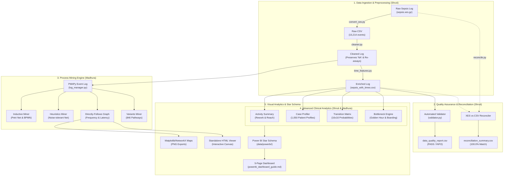

# CareFlow: System Architecture & Data Engineering Flow

> **Project:** CareFlow – Patient Journey Analysis Using Process Mining  
> **Authors:** Shruti (Member 1 - Data Engineering) & Madhura (Member 2 - Process Mining)  
> **Repository:** `D:\Projects\CareFlow-Clinical-Process-Intelligence`  
> **Branch:** `shruti`  

---

## 1. Architectural Overview

CareFlow is an end-to-end clinical pathway intelligence platform designed to ingest raw, timestamped electronic health record (EHR) event logs, standardize and validate multi-attribute clinical data, discover objective patient treatment pathways using process mining algorithms, and expose operational bottlenecks and care variations via interactive visual analytics and a Power BI Star-Schema data model.



---

## 2. Component Breakdown

### Component 1: Data Ingestion & Cleaning Engine (`src/data/`)
- **`loader.py`**: Safe dataset loader that strictly enforces `keep_default_na=False` and `na_values=[""]` with explicit string typing for Case ID. This prevents the valid pseudonymized patient identifier `"NA"` from being dropped as `NaN`.
- **`convert_xes.py`**: Decompresses and extracts IEEE 1849 XES XML streams directly into structured tabular format using PM4Py.
- **`cleaner.py`**: Standardizes timestamps to ISO-8601 UTC datetimes, sorts chronologically using stable sorting, and retains genuine same-timestamp clinical repeat assays (e.g. multi-tube blood tests).
- **`time_features.py`**: Computes sequential step numbering (`event_sequence_nr`), prior activity references, and non-negative elapsed minutes within each case.

### Component 2: Quality Assurance & Reconciliation (`src/validation/`)
- **`validator.py`**: Evaluates 10 automated data quality checks across missing values, chronological monotonicity, and non-negative elapsed times.
- **`reconciliation.py`**: Conducts multi-attribute cross-verification between raw XES and processed CSV on `(case_id, activity, timestamp)`. Proves zero missing events, zero extra events, and a 100.0% reconciliation match.

### Component 3: Process Mining Engine (`src/process_mining/`)
- **`log_manager.py`**: Wraps cleaned DataFrames into PM4Py EventLog structures with formal classifiers (`case:concept:name`, `concept:name`, `time:timestamp`).
- **`inductive_miner.py`**: Discovers formal, block-structured process trees and transforms them into standard Petri Nets (`.pnml`) and BPMN diagrams (`.bpmn`) with guaranteed soundness.
- **`heuristics_miner.py`**: Applies frequency-based dependency thresholds to mine noise-tolerant Heuristics Petri Nets and dependency matrices.
- **`dfg_miner.py`**: Computes Directly-Follows Graphs for frequency (edge counts) and performance (mean/median transition hours).
- **`variants_miner.py`**: Extracts all 846 distinct trace pathways and calculates Pareto cumulative coverage distributions.

### Component 4: Advanced Clinical Analytics (`src/analysis/`)
- **`activity_summary.py`**: Measures total volume, patient reach %, repetition counts, and rework rates across all 16 clinical activities.
- **`case_profiler.py`**: Profiles all 1,050 patient cases with entry/exit activities, clinical cohorts (Age, SIRS, Infection, ICU), and duration metrics.
- **`transitions_analysis.py`**: Computes the full $16 \times 16$ transition probability matrix $P(B \mid A)$ and waiting-time IQR statistics.
- **`bottleneck_analysis.py`**: Evaluates clinical compliance against the Surviving Sepsis Campaign Golden Hour ($\le 1$ hour) and ER boarding latency.

### Component 5: Visual Analytics & Power BI Integration (`src/visualization/` & `data/powerbi/`)
- **`process_map.py`**: Generates publication-ready 300 DPI process flow maps using pure Matplotlib and NetworkX without requiring Graphviz system executables.
- **`interactive_map.py`**: Emits an offline, responsive HTML5 canvas viewer allowing interactive node dragging, edge threshold filtering, and metric inspection.
- **`prepare_powerbi_data.py`**: Exports 7 Star-Schema tables for interactive reporting in Microsoft Power BI.

---

## 3. Directory Layout

```text
D:\Projects\CareFlow-Clinical-Process-Intelligence/
├── .gitignore
├── README.md                               # Master project documentation
├── requirements.txt                        # Accurate Python dependencies
├── run_pipeline.py                         # Master end-to-end execution script
├── data/
│   ├── raw/
│   │   └── sepsis.xes.gz                  # Original raw Sepsis event log
│   ├── processed/
│   │   ├── sepsis_event_log.csv           # Raw extracted CSV (15,214 events)
│   │   ├── sepsis_cleaned.csv             # Cleaned, standardized CSV
│   │   ├── sepsis_with_times.csv          # Enriched CSV with elapsed times
│   │   ├── patient_case_summary.csv       # Case-level summary (1,050 cases)
│   │   ├── activity_frequency.csv         # Activity occurrences (16 activities)
│   │   └── activity_time_differences.csv  # Transition differences (115 pairs)
│   └── powerbi/                           # Star-Schema dashboard tables
│       ├── fact_event_log.csv             # 15,214 rows
│       ├── dim_patient_cases.csv          # 1,050 rows
│       ├── dim_activities.csv             # 16 rows
│       ├── fact_transitions.csv          # 115 rows
│       ├── dim_variants.csv               # 846 rows
│       ├── fact_bottlenecks.csv           # 1,050 rows
│       └── dim_data_quality.csv           # 10 rows
├── docs/                                  # Complete technical documentation suite
│   ├── project_architecture.md            # Architecture & data flow
│   ├── data_dictionary.md                 # Complete schema and column catalog
│   ├── methodology.md                     # Process mining theory & algorithms
│   ├── execution_guide.md                 # Setup & running instructions
│   ├── testing_report.md                  # Automated testing results
│   ├── team_contributions.md              # Division of responsibilities
│   ├── presentation_guide.md              # Viva & college presentation guide
│   ├── interview_questions.md             # Technical interview Q&A
│   └── archive/                           # Archived legacy templates
├── outputs/
│   ├── figures/                           # Process maps & variant charts
│   │   ├── dfg_frequency_process_map.png
│   │   ├── dfg_performance_bottleneck_map.png
│   │   ├── top_variants_distribution.png
│   │   └── careflow_interactive_process_map.html
│   ├── models/                            # Process discovery models
│   │   ├── inductive_petri_net.pnml
│   │   ├── inductive_bpmn.bpmn
│   │   └── heuristics_petri_net.pnml
│   └── tables/                            # Analytical tables
│       ├── activity_frequency_detailed.csv
│       ├── activity_transition_matrix.csv
│       ├── activity_transitions_detailed.csv
│       ├── admission_latency_analysis.csv
│       ├── clinical_bottlenecks_summary.csv
│       ├── dfg_frequency_table.csv
│       ├── dfg_performance_table.csv
│       ├── heuristics_dependency_matrix.csv
│       ├── patient_case_profiles.csv
│       ├── process_variants_summary.csv
│       └── triage_to_antibiotics_analysis.csv
├── reports/                               # Validation & reconciliation reports
│   ├── data_quality_report.csv
│   ├── events_missing_from_csv.csv
│   ├── extra_events_in_csv.csv
│   ├── final_data_validation_report.csv
│   ├── reconciliation_summary.csv
│   └── powerbi_dashboard_guide.md         # Full Power BI specification
├── src/                                   # Modular source code
│   ├── analysis/                          # Analytics engine
│   ├── data/                              # Data engineering engine
│   ├── process_mining/                    # PM4Py discovery engine
│   ├── validation/                        # QA & reconciliation engine
│   └── visualization/                     # Static & interactive visualizers
└── tests/                                 # Automated test suite (31 tests)
    ├── run_all_tests.py                   # Master test runner
    ├── test_data_pipeline.py              # Data engineering tests (5 tests)
    ├── test_process_mining.py             # PM4Py discovery tests (6 tests)
    ├── test_advanced_analysis.py          # Analytics & bottleneck tests (7 tests)
    ├── test_powerbi_exports.py            # Power BI schema tests (7 tests)
    └── test_end_to_end.py                 # System integration tests (6 tests)
```
