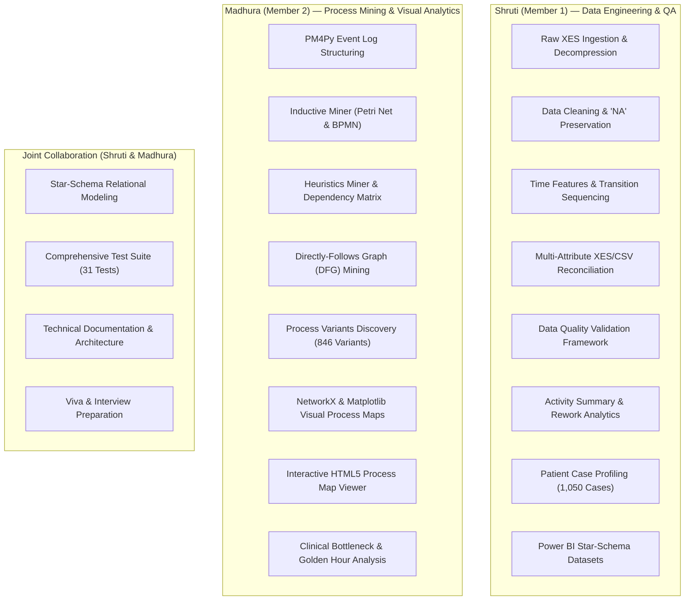

# CareFlow: Team Roles, Contributions & Code Ownership

> **Project:** CareFlow – Patient Journey Analysis Using Process Mining  
> **Team Size:** 2 Members  
> **Repository:** `D:\Projects\CareFlow-Clinical-Process-Intelligence`  
> **Branch:** `shruti`  

---

## 1. Overview & Team Structure

To maintain complete academic integrity and professional transparency during evaluation, viva voce, and technical interviews, the responsibilities and contributions of each team member are explicitly documented below. Work is honestly attributed according to technical execution.

---

## 2. Detailed Member Responsibilities

### Member 1: Shruti
**Domain:** Data Engineering, Preprocessing, Validation & Pipeline Reliability
- **Raw Data Ingestion:** Implemented XES decompression and tabular translation from `sepsis.xes.gz` using PM4Py.
- **The Case 'NA' Resolution:** Diagnosed and engineered the solution for preserving the valid pseudonymized patient identifier `"NA"`. Configured `keep_default_na=False, na_values=[""]` with explicit string typing in `src/data/loader.py`, recovering the 24 missing events and restoring the dataset from 15,189 to the verified 15,214 events.
- **Clinical Repeat Assays Preservation:** Identified that same-timestamp events for patient `"ES"` and others represented legitimate clinical multi-tube blood tests rather than technical duplicates, preventing data loss.
- **Time Feature Engineering:** Implemented within-case chronological sequencing, computing prior timestamps and non-negative elapsed minutes (`elapsed_minutes`).
- **Data Quality & Reconciliation Engine:** Developed `src/validation/validator.py` and `src/validation/reconciliation.py`, proving a **100.0% zero-defect reconciliation match** between raw XES and processed CSV.
- **Case Profiling & Workload Analytics:** Engineered case-level aggregation for all 1,050 patient profiles (`patient_case_profiles.csv`) and activity occurrence summaries (`activity_frequency_detailed.csv`).
- **Power BI Data Preparation:** Structured and exported the Star-Schema CSV suite in `data/powerbi/`.

### Member 2: Madhura
**Domain:** Process Mining, PM4Py Implementation, Algorithmic Discovery & Visual Analytics
- **PM4Py Event Log Integration:** Configured standard event log classifiers (`case:concept:name`, `concept:name`, `time:timestamp`) and trace classifiers.
- **Inductive Miner Implementation:** Discovered formal, block-structured process trees and exported mathematically sound Petri Nets (`inductive_petri_net.pnml`) and standard BPMN XML models (`inductive_bpmn.bpmn`).
- **Heuristics Miner Implementation:** Applied relative-to-best frequency thresholds to mine noise-tolerant Heuristics Petri Nets (`heuristics_petri_net.pnml`) and generated the $16 \times 16$ activity dependency matrix.
- **Directly-Follows Graph (DFG):** Mined frequency DFG and performance DFG across 115 unique transitions and 14,164 event connections.
- **Process Variants Analytics:** Discovered and classified all 846 unique patient pathways, analyzing Pareto distributions and cumulative case coverage.
- **Dependency-Free Process Visualizations:** Designed and coded publication-quality process maps using pure **NetworkX and Matplotlib**, completely eliminating external Graphviz system dependencies.
- **Interactive Process Map:** Built the standalone, offline HTML5 canvas viewer (`careflow_interactive_process_map.html`) with interactive node dragging and edge threshold filtering.
- **Clinical Bottleneck Analysis:** Analyzed Surviving Sepsis Campaign Golden Hour compliance ($\le 1$ hour) and emergency ward boarding latencies.

---

## 3. Code Ownership Matrix

| Source File / Module | Primary Author | Secondary Contributor | Technical Scope |
| :--- | :---: | :---: | :--- |
| `src/data/loader.py` | Shruti | Madhura | Safe I/O, 'NA' string handling, column normalization |
| `src/data/convert_xes.py` | Shruti | — | XES decompression and initial CSV generation |
| `src/data/cleaner.py` | Shruti | — | Timestamp standardization, duplicate assay preservation |
| `src/data/time_features.py` | Shruti | — | Chronological ordering, elapsed minutes computation |
| `src/validation/validator.py` | Shruti | — | Automated data quality checks (PASS/FAIL) |
| `src/validation/reconciliation.py`| Shruti | — | Multi-attribute XES vs CSV reconciliation |
| `src/process_mining/log_manager.py`| Madhura | Shruti | PM4Py DataFrame & EventLog object creation |
| `src/process_mining/inductive_miner.py`| Madhura | — | Inductive Miner, Petri Net & BPMN exports |
| `src/process_mining/heuristics_miner.py`| Madhura | — | Heuristics Miner & dependency matrix calculation |
| `src/process_mining/dfg_miner.py` | Madhura | — | Frequency & latency DFG extraction |
| `src/process_mining/variants_miner.py`| Madhura | — | 846 process variants extraction & Pareto analysis |
| `src/visualization/process_map.py`| Madhura | — | NetworkX/Matplotlib publication-quality maps |
| `src/visualization/interactive_map.py`| Madhura | — | Offline HTML5 interactive visualizer |
| `src/analysis/activity_summary.py`| Shruti | Madhura | Activity frequency, case reach, rework rates |
| `src/analysis/case_profiler.py` | Shruti | — | Patient case profiles (1,050 cases) & clinical flags |
| src/analysis/transitions_analysis.py| Shruti | Madhura | Transition matrix & probability calculation |
| src/analysis/bottleneck_analysis.py| Shruti | Madhura | Sepsis Golden Hour & ER boarding latency |
| src/dashboard/app.py | Madhura | Shruti | Interactive Streamlit Clinical Dashboard (11 modules) |
| `src/prepare_powerbi_data.py` | Shruti | Madhura | Power BI Star-Schema table generation |
| `run_pipeline.py` | Shruti | Madhura | Master orchestrator & resource benchmark |
| `tests/run_all_tests.py` | Shruti | Madhura | Test runner executing all 31 test cases |
| `tests/test_data_pipeline.py` | Shruti | — | Unit tests for data pipeline & reconciliation |
| `tests/test_process_mining.py` | Madhura | — | Unit tests for PM4Py models & DFG |
| `tests/test_advanced_analysis.py`| Shruti | Madhura | Unit tests for rework, profiles, and bottlenecks |
| `tests/test_powerbi_exports.py` | Shruti | — | Unit tests for Star-Schema tables |
| `tests/test_end_to_end.py` | Shruti | Madhura | Integration & mathematical identity tests |
