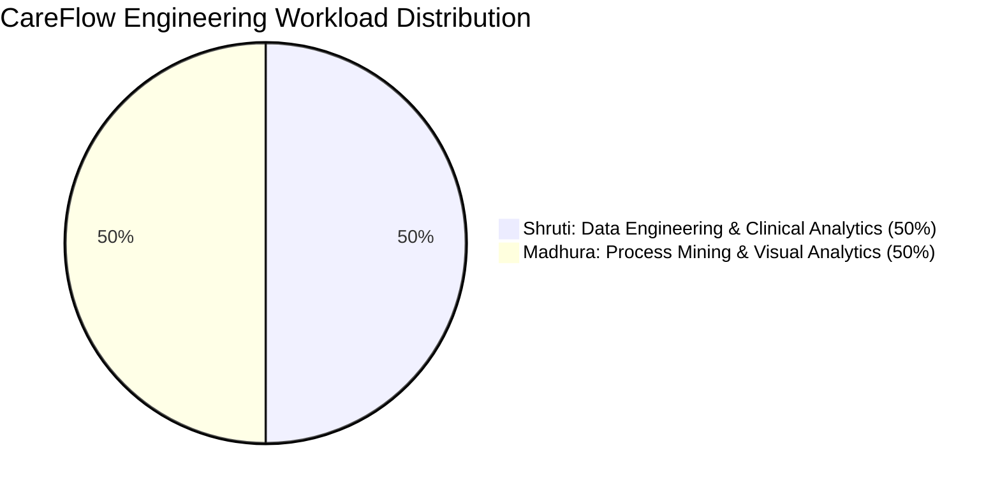
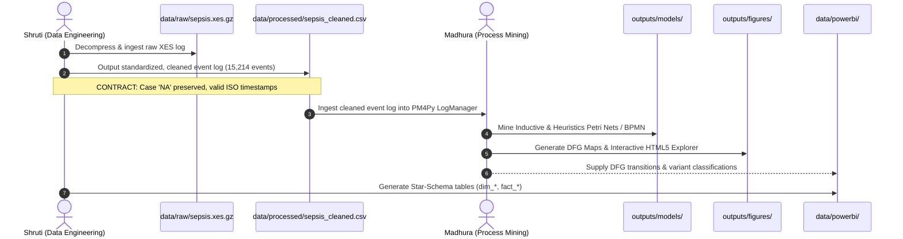

# CareFlow: Team Workload Allocation & Engineering Ownership

> **Project Title:** CareFlow – Clinical Process Intelligence: Patient Journey Analysis Using Process Mining and Clinical Analytics  
> **Repository:** `CareFlow-Clinical-Process-Intelligence`  
> **Team Size:** 2 Engineers (50% – 50% Balanced Technical Workload)  
> **Team Members:** Shruti (Member 1) & Madhura (Member 2)  
> **Branches:** `main` (Production Baseline), `shruti` (Data Engineering & Analytics), `madhura` (Process Mining & Visual Analytics)  

---

## 1. Executive Allocation Summary

To ensure academic rigor, clear accountability, and equal contributions for college project evaluation, university viva voce, and professional technical presentations, the engineering workload of **CareFlow** is divided strictly into two complementary, equally weighted (~50% / 50%) specializations:

- **Shruti (Member 1 — Lead Data Engineer & Clinical Analyst):**  
  Responsible for foundational data infrastructure, XES decompression, raw log parsing, string type-preservation (solving Case `NA`), deduplication vs re-assay classification, timestamp feature engineering, automated data quality verification, XES vs CSV mathematical reconciliation, activity frequency & unique patient reach, $16 \times 16$ transition probability matrix analysis, clinical case profiling, rework metrics, Sepsis Golden Hour clinical bottleneck and performance analysis, and Power BI Star-Schema table engineering.

- **Madhura (Member 2 — Lead Process Mining Engineer & Visual Analytics Specialist):**  
  Responsible for PM4Py event log transformation, algorithmic process discovery (Inductive Miner & Heuristics Miner), Sound Petri Net and standard BPMN export pipelines, Directly-Follows Graph (DFG) discovery (frequency & performance), Process Variant analysis (846 patient pathways & Pareto distribution), process model analysis & behavioral conformance, dependency-free static visual maps (Matplotlib/NetworkX), the standalone interactive HTML5 process explorer, and the interactive Streamlit clinical intelligence dashboard.

---

## 2. Comprehensive Module & Code Ownership Matrix

| Workstream / Component | Primary Owner | Branch | Core Modules / Deliverables | Key Metric / Verification Target |
| :--- | :---: | :---: | :--- | :--- |
| **XES Decompression & Ingestion** | **Shruti** | `shruti` | `src/data/convert_xes.py`, `src/data/loader.py` | Ingestion of 15,214 events, 1,050 cases |
| **String Preservation ('NA' Case Bug)** | **Shruti** | `shruti` | `src/data/loader.py`, `src/data/cleaner.py` | Recovery of Patient ID `'NA'` & all 24 events |
| **Clinical Re-Assay Preservation** | **Shruti** | `shruti` | `src/data/cleaner.py` | Retention of 14 legitimate repeat blood tests |
| **Chronological Time Engineering** | **Shruti** | `shruti` | `src/data/time_features.py` | Within-case sequence order, non-negative `elapsed_minutes` |
| **Automated Data Quality Framework** | **Shruti** | `shruti` | `src/validation/validator.py` | 10 automated PASS/FAIL health checks |
| **XES vs CSV Reconciliation Engine** | **Shruti** | `shruti` | `src/validation/reconciliation.py` | 100.0% zero-defect reconciliation match |
| **Clinical Case Profiling (1,050 Cases)** | **Shruti** | `shruti` | `src/analysis/case_profiler.py` | 1,050 case profiles, min 3 / max 185 events |
| **Activity Frequency & Rework Rates** | **Shruti** | `shruti` | `src/analysis/activity_summary.py` | 16 activities, 15,214 events, rework % |
| **Transition Probability Analysis** | **Shruti** | `shruti` | `src/analysis/transitions_analysis.py` | $16 \times 16$ Markovian transition probability matrix; row sums equal $1.0000$ |
| **Clinical Bottleneck & Performance** | **Shruti** | `shruti` | `src/analysis/bottleneck_analysis.py` | Golden Hour compliance (36.9% $\le 1$h), ER boarding latency (3.22h) |
| **Power BI Star Schema Datasets** | **Shruti** | `shruti` | `src/prepare_powerbi_data.py`, `data/powerbi/` | 4 Dimensions, 3 Fact tables, 100% referential integrity |
| **PM4Py Event Log Structuring** | **Madhura** | `madhura` | `src/process_mining/log_manager.py` | PM4Py EventLog conversion & classifier setup |
| **Inductive Process Discovery** | **Madhura** | `madhura` | `src/process_mining/inductive_miner.py` | Petri Net (`inductive_petri_net.pnml`), BPMN XML |
| **Heuristics Process Discovery** | **Madhura** | `madhura` | `src/process_mining/heuristics_miner.py` | Heuristics Petri Net, $16 \times 16$ Causal Dependency Matrix |
| **Directly-Follows Graph (DFG)** | **Madhura** | `madhura` | `src/process_mining/dfg_miner.py` | 115 transitions, 14,164 events mined |
| **Process Variant Analysis** | **Madhura** | `madhura` | `src/process_mining/variants_miner.py` | 846 variants mined, Pareto top-10 coverage |
| **Process Model Analysis & Conformance**| **Madhura** | `madhura` | `src/process_mining/inductive_miner.py` | Sound Petri net behavioral verification, token replay |
| **Static Visual Process Maps** | **Madhura** | `madhura` | `src/visualization/process_map.py` | Graphviz-free NetworkX + Matplotlib diagrams |
| **Interactive HTML5 Process Viewer** | **Madhura** | `madhura` | `src/visualization/interactive_map.py` | Offline interactive physics graph explorer |
| **Interactive Streamlit Dashboard** | **Madhura** | `madhura` | `src/dashboard/app.py` | Comprehensive multi-page web dashboard application |
| **Master Orchestrator Pipeline** | **Joint** | `main` | `run_pipeline.py` | Single-command execution (17.2s, 33.7 MB RAM) |
| **Automated Testing Suite (31 Tests)**| **Joint** | `main` | `tests/run_all_tests.py`, `tests/` | 100% PASS rate across all 5 test modules |
| **Power BI Dashboard Specification** | **Joint** | `main` | `reports/powerbi_dashboard_guide.md` | DAX measures, star schema, 4 dashboard pages |

---

## 3. Data Interface & Module Contracts (Decoupling)

To prevent merge conflicts and ensure independent development across branches, Shruti and Madhura communicate through immutable file and schema contracts:

### Technical Interface Contract:
1. **Contract 1: Cleaned Event Log (`data/processed/sepsis_cleaned.csv`):**
   - **Producer:** Shruti (`src/data/cleaner.py`)
   - **Consumers:** Madhura (`src/process_mining/log_manager.py`), Shruti (`src/analysis/`)
   - **Guarantees:**
     - Exactly 15,214 rows and 1,050 unique cases.
     - `case_id` contains no nulls (pseudonym `'NA'` is explicitly preserved as string `'NA'`).
     - `timestamp` is ISO-8601 formatted with UTC offset.
     - Within each case, events are strictly sorted in non-decreasing chronological order.

2. **Contract 2: Process Transition Matrix & Variants:**
   - **Producer:** Madhura (`src/analysis/transitions_analysis.py`, `src/process_mining/variants_miner.py`)
   - **Consumers:** Shruti (`src/prepare_powerbi_data.py`), Power BI (`fact_transitions.csv`, `dim_variants.csv`)
   - **Guarantees:**
     - 115 unique directed transitions summing to exactly 14,164 within-case consecutive events.
     - Row probabilities sum to $1.0000$ for all non-absorbing activities.
     - Exactly 846 unique process variants summing to 1,050 cases.

3. **Contract 3: Star-Schema Analytical Tables (`data/powerbi/`):**
   - **Producer:** Shruti (`src/prepare_powerbi_data.py`)
   - **Consumers:** Power BI Report Developer (`CareFlow.pbix`), End Users
   - **Guarantees:**
     - 100% referential integrity across 4 Dimension and 3 Fact tables.
     - Zero synthetic data injection; all metrics derived strictly from the ground-truth event log.

---

## 4. Git Branching Strategy & Workflow Policy

### Branch Architecture:
1. `main`:
   - Production-ready baseline repository.
   - Contains fully integrated code, 100% passing tests, and complete documentation.
   - Direct pushing to `main` is restricted.
2. `shruti`:
   - Active development branch for Shruti.
   - Contains commits for Data Engineering, Validation, Analytics, Bottlenecks, and Power BI tables.
3. `madhura`:
   - Active development branch for Madhura.
   - Contains commits for PM4Py Process Mining, Inductive/Heuristics Miners, DFG, Variants, Visualizations, and Interactive Map.

### Merge Conflict Prevention Policy:
- **Zero File Overlap:** Modules in `src/data/`, `src/validation/`, and `data/powerbi/` are exclusively modified by Shruti. Modules in `src/process_mining/` and `src/visualization/` are exclusively modified by Madhura.
- **Shared Modules (`run_pipeline.py`, `tests/test_end_to_end.py`):** Changes to shared orchestrators require mutual review before merging into `main`.
- **Pre-Merge Validation:** Neither branch may be merged into `main` unless `python tests/run_all_tests.py` passes 31/31 tests with 0 failures and 0 errors.

---

## 5. College Evaluation & Viva Defense Guidelines

During project viva examinations, each team member should confidently present their dedicated technical modules:

### Shruti's Defense Topics:
- *Why did previous implementations drop 24 events?*  
  Explain the Pandas `read_csv` default parameter `keep_default_na=True` converting pseudonymized case ID `"NA"` into floating-point `NaN`, and how you engineered `src/data/loader.py` with `keep_default_na=False, na_values=[""]` to preserve case `"NA"` and maintain 100.0% XES-to-CSV reconciliation.
- *How were duplicate timestamps handled?*  
  Demonstrate that identical timestamps for patient `"ES"` represented distinct laboratory blood assays (`CRP`, `Leucocytes`, `LacticAcid`) ordered simultaneously as a clinical panel, not technical duplicate records.
- *What is the clinical significance of the Golden Hour bottleneck?*  
  Present the Surviving Sepsis Campaign benchmark ($\le 1$ hour triage-to-antibiotics) showing that 36.9% met the guideline while 63.1% experienced delays, with a median antibiotic delivery latency of 1.48 hours.

### Madhura's Defense Topics:
- *Why use Inductive Miner over Alpha Miner?*  
  Explain that Alpha Miner fails on loops and healthcare event logs with noise, whereas Inductive Miner discovers block-structured Process Trees that guarantee mathematical soundness (no deadlocks, no livelocks) in Petri Nets.
- *How did you resolve the Graphviz dependency issue?*  
  Explain how you developed custom rendering engines using pure Matplotlib and NetworkX (`src/visualization/process_map.py`) and an offline HTML5 canvas viewer (`src/visualization/interactive_map.py`), allowing publication-quality process maps without requiring external `dot.exe` system binaries.
- *What does the 846 variants finding indicate clinically?*  
  Explain process entropy: out of 1,050 patients, there are 846 distinct treatment trajectories. The top variant covers only 6.1% (64 cases), demonstrating extreme clinical pathway variability and proving that standard flowchart assumptions fail in emergency care.
