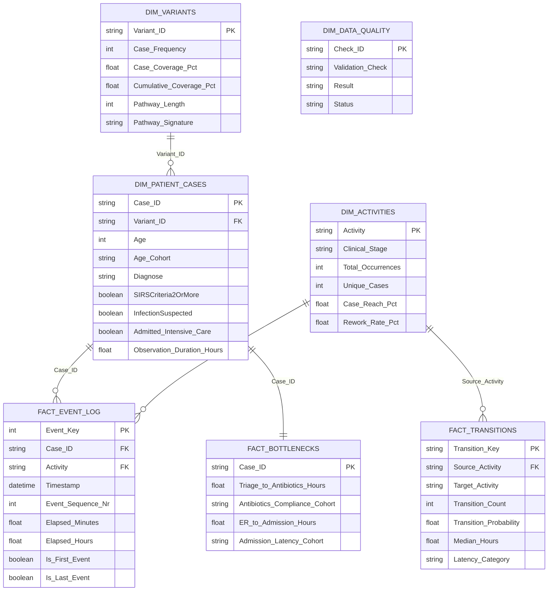

# CareFlow: Power BI Dashboard & Star-Schema Data Model Specification

> **Project:** CareFlow – Patient Journey Analysis Using Process Mining  
> **Target Tool:** Microsoft Power BI Desktop / Service  
> **Source Directory:** `data/powerbi/`  
> **Verification Status:** 100% Reconciled (15,214 Events, 1,050 Cases, 16 Activities)  
> **Authors:** Shruti (Member 1 - Data Engineering) & Madhura (Member 2 - Process Analytics)  

---

## 1. Executive Summary & Star-Schema Data Model

The CareFlow Power BI architecture transforms normalized process mining event logs into a high-performance **Star-Schema** relational model. This eliminates complex runtime table scanning, ensures sub-second visual responsiveness, and enables interactive cross-filtering across clinical stages, patient demographics, process variants, and transition latencies.



---

## 2. Power BI Table Dictionary

| Table Name | File Name | Role | Primary Key | Foreign Keys | Row Count | Description |
| :--- | :--- | :---: | :---: | :---: | :---: | :--- |
| **Fact_Event_Log** | `fact_event_log.csv` | Fact | `Event_Key` | `Case_ID`, `Activity` | 15,214 | Chronological event stream with step orders and elapsed time |
| **Dim_Patient_Cases** | `dim_patient_cases.csv` | Dimension | `Case_ID` | `Variant_ID` | 1,050 | Patient attributes, demographics, ICU status, and case durations |
| **Dim_Activities** | `dim_activities.csv` | Dimension | `Activity` | — | 16 | Clinical stages, overall frequency, and rework metrics |
| **Fact_Transitions** | `fact_transitions.csv` | Fact | `Transition_Key` | `Source_Activity` | 115 | Directed transition pairs, conditional probabilities, and waiting times |
| **Dim_Variants** | `dim_variants.csv` | Dimension | `Variant_ID` | — | 846 | Unique journey pathways, Pareto coverage, and signature paths |
| **Fact_Bottlenecks** | `fact_bottlenecks.csv` | Fact | `Case_ID` | `Case_ID` | 1,050 | Golden hour antibiotics and ER-to-ward boarding metrics |
| **Dim_Data_Quality** | `dim_data_quality.csv` | Dimension | `Check_ID` | — | 10 | Audit verification report with PASS/INFO statuses |

---

## 3. Recommended Table Relationships

Configure the following relationships in Power BI Model View (Set Cross-filter direction to **Single**):

1. **`Dim_Patient_Cases` [Case_ID]** $\rightarrow$ **`Fact_Event_Log` [Case_ID]**  
   - Cardinality: **1 to Many (1:*)**
2. **`Dim_Activities` [Activity]** $\rightarrow$ **`Fact_Event_Log` [Activity]**  
   - Cardinality: **1 to Many (1:*)**
3. **`Dim_Variants` [Variant_ID]** $\rightarrow$ **`Dim_Patient_Cases` [Variant_ID]**  
   - Cardinality: **1 to Many (1:*)**
4. **`Dim_Patient_Cases` [Case_ID]** $\rightarrow$ **`Fact_Bottlenecks` [Case_ID]**  
   - Cardinality: **1 to 1 (1:1)**
5. **`Dim_Activities` [Activity]** $\rightarrow$ **`Fact_Transitions` [Source_Activity]**  
   - Cardinality: **1 to Many (1:*)**
6. **`Dim_Data_Quality`**: Standalone audit reference table (no relationships needed).

---

## 4. DAX Measures Catalog

Create a dedicated measures table named `_Measures` and insert the following formulas:

### A. Volume & Cohort KPIs
```dax
Total_Events = COUNTROWS(Fact_Event_Log)

Total_Patients = DISTINCTCOUNT(Dim_Patient_Cases[Case_ID])

Total_Activities = DISTINCTCOUNT(Dim_Activities[Activity])

Total_Variants = COUNTROWS(Dim_Variants)

Total_Transitions = SUM(Fact_Transitions[Transition_Count])

Avg_Events_Per_Patient = DIVIDE([Total_Events], [Total_Patients], 0)
```

### B. Clinical Compliance & Care Quality KPIs
```dax
ICU_Admission_Rate = 
DIVIDE(
    CALCULATE([Total_Patients], Dim_Patient_Cases[Admitted_Intensive_Care] = TRUE()),
    [Total_Patients],
    0
)

Return_ER_Rate = 
DIVIDE(
    CALCULATE([Total_Patients], Dim_Patient_Cases[Had_Return_ER] = TRUE()),
    [Total_Patients],
    0
)

Antibiotics_Golden_Hour_Rate = 
DIVIDE(
    CALCULATE(COUNTROWS(Fact_Bottlenecks), Fact_Bottlenecks[Antibiotics_Compliance_Cohort] = "1. Golden Hour (<= 1h)"),
    CALCULATE(COUNTROWS(Fact_Bottlenecks), Fact_Bottlenecks[Antibiotics_Compliance_Cohort] IN {"1. Golden Hour (<= 1h)", "2. Sepsis Bundle (1 - 3h)", "3. Delayed (> 3h)"}),
    0
)

Sepsis_3Hour_Bundle_Rate = 
DIVIDE(
    CALCULATE(COUNTROWS(Fact_Bottlenecks), Fact_Bottlenecks[Antibiotics_Compliance_Cohort] IN {"1. Golden Hour (<= 1h)", "2. Sepsis Bundle (1 - 3h)"}),
    CALCULATE(COUNTROWS(Fact_Bottlenecks), Fact_Bottlenecks[Antibiotics_Compliance_Cohort] IN {"1. Golden Hour (<= 1h)", "2. Sepsis Bundle (1 - 3h)", "3. Delayed (> 3h)"}),
    0
)

Rapid_Admission_Rate = 
DIVIDE(
    CALCULATE(COUNTROWS(Fact_Bottlenecks), Fact_Bottlenecks[Admission_Latency_Cohort] = "1. Rapid (<= 4h)"),
    CALCULATE(COUNTROWS(Fact_Bottlenecks), Fact_Bottlenecks[Admission_Latency_Cohort] IN {"1. Rapid (<= 4h)", "2. Standard (4 - 8h)", "3. Prolonged (> 8h)"}),
    0
)
```

### C. Duration & Latency KPIs
```dax
Median_Observation_Duration_Days = MEDIAN(Dim_Patient_Cases[Observation_Duration_Days])

Average_Observation_Duration_Days = AVERAGE(Dim_Patient_Cases[Observation_Duration_Days])

Median_Triage_to_Antibiotics_Hours = 
CALCULATE(
    MEDIAN(Fact_Bottlenecks[Triage_to_Antibiotics_Hours]),
    Fact_Bottlenecks[Triage_to_Antibiotics_Hours] > 0
)

Median_ER_to_Admission_Hours = 
CALCULATE(
    MEDIAN(Fact_Bottlenecks[ER_to_Admission_Hours]),
    Fact_Bottlenecks[ER_to_Admission_Hours] > 0
)

Global_Rework_Index = 
DIVIDE(
    SUM(Dim_Activities[Repeated_Cases_Count]),
    SUM(Dim_Activities[Unique_Cases]),
    0
)
```

---

## 5. Page-by-Page Dashboard Design Specification

### Page 1: Overall Patient Journey Overview
*Objective: High-level executive snapshot of patient volumes, admission pathways, and clinical cohorts.*

- **Top KPI Cards:**
  1. **Total Patients:** `1,050` (`[Total_Patients]`)
  2. **Total Events:** `15,214` (`[Total_Events]`)
  3. **Avg Events / Case:** `14.5` (`[Avg_Events_Per_Patient]`)
  4. **Median Observation Span:** `5.3 Days` (`[Median_Observation_Duration_Days]`)
  5. **ICU Admission Rate:** `10.5%` (`[ICU_Admission_Rate]`)
  6. **Return ER Rate:** `28.0%` (`[Return_ER_Rate]`)
- **Visual 1 (Donut Chart):** Inpatient Care Disposition (`Admitted_Normal_Care`, `Admitted_Intensive_Care`, `Discharged from ER`).
- **Visual 2 (Clustered Bar Chart):** Patient Volume by Age Cohort (`Under 45`, `45 - 64`, `65 - 79`, `80+`).
- **Visual 3 (Stacked Bar Chart):** Primary Exit Distribution (`Release A` [63.9%], `Return ER` [28.0%], `Release B` [5.3%], `Release C-E` [2.8%]).
- **Visual 4 (Line Chart):** Chronological Inflow Trend (Date vs New Patient Registrations).
- **Slicers:** `Age_Cohort`, `Duration_Cohort`, `SIRSCriteria2OrMore`, `InfectionSuspected`.

---

### Page 2: Activity & Clinical Workload Analysis
*Objective: Explore clinical activity workload, laboratory monitoring, and rework intensities.*

- **Top KPI Cards:**
  1. **Unique Activities:** `16` (`[Total_Activities]`)
  2. **Top Activity by Volume:** `Leucocytes` (3,383 events)
  3. **Highest Rework Activity:** `CRP` (68.7% repetition rate)
  4. **Global Rework Index:** `19.2%` (`[Global_Rework_Index]`)
- **Visual 1 (Horizontal Bar Chart):** Total Occurrences by Activity colored by `Clinical_Stage`.
- **Visual 2 (Scatter Plot):** Patient Reach % ($X$-axis) vs Rework Rate % ($Y$-axis), Bubble Size = Total Occurrences. Highlights high-volume, high-repetition diagnostic tests (`CRP`, `Leucocytes`).
- **Visual 3 (Stacked Column Chart):** Distribution of Activity Occurrences by Clinical Stage (`1. Intake`, `2. Diagnostics`, `3. Treatments`, `4. Inpatient`, `5. Disposition`).
- **Visual 4 (Table Visual):** Activity Workload Breakdown (`Activity`, `Clinical_Stage`, `Total_Occurrences`, `Unique_Cases`, `Case_Reach_Pct`, `Rework_Rate_Pct`, `Max_Repetitions`).
- **Slicers:** `Clinical_Stage`, `Activity Name`.

---

### Page 3: Process Flow & Variants
*Objective: Analyze pathway diversity, dominant treatment sequences, and Pareto distribution.*

- **Top KPI Cards:**
  1. **Total Unique Variants:** `846` (`[Total_Variants]`)
  2. **Top Variant Share (V001):** `3.33%` (35 cases)
  3. **Top 10 Variants Share:** `12.98%` (136 cases)
  4. **Average Pathway Length:** `14.5 Steps`
- **Visual 1 (Pareto Chart - Combo Chart):** Top 15 Process Variants. Column = `Case_Frequency`, Line = `Cumulative_Coverage_Pct` (Secondary Axis).
- **Visual 2 (Matrix Visual):** Activity Transition Matrix. Rows = `Source_Activity`, Columns = `Target_Activity`, Values = `Transition_Count` (Conditional Formatting with blue data bars).
- **Visual 3 (Histogram / Column Chart):** Pathway Length Distribution (Number of Steps vs Patient Count).
- **Visual 4 (Table Visual):** Variant Details Table (`Variant_ID`, `Case_Frequency`, `Case_Coverage_Pct`, `Pathway_Length`, `Entry_Activity`, `Exit_Activity`, `Pathway_Signature`).
- **Slicers:** `Variant_ID`, `Entry_Activity`, `Exit_Activity`.

---

### Page 4: Waiting Time & Bottlenecks
*Objective: Identify operational delays, Sepsis Golden Hour adherence, and hospital boarding latencies.*

- **Top KPI Cards:**
  1. **Sepsis Golden Hour Rate (<= 1h):** `36.9%` (`[Antibiotics_Golden_Hour_Rate]`)
  2. **3-Hour Bundle Adherence:** `74.8%` (`[Sepsis_3Hour_Bundle_Rate]`)
  3. **Median Triage-to-Antibiotics:** `1.73 Hours` (`[Median_Triage_to_Antibiotics_Hours]`)
  4. **Median ER Boarding Time:** `3.22 Hours` (`[Median_ER_to_Admission_Hours]`)
- **Visual 1 (Donut / Bar Chart):** Triage-to-Antibiotics Compliance Cohort (`1. Golden Hour (<= 1h)` [304], `2. Sepsis Bundle (1 - 3h)` [312], `3. Delayed (> 3h)` [207]).
- **Visual 2 (Column Chart):** ER-to-Inpatient Ward Boarding Time Distribution (`< 4 Hours` [73.8%], `4 - 8 Hours` [25.7%], `> 8 Hours` [0.5%]).
- **Visual 3 (Clustered Bar Chart):** Top 10 Delayed Process Transitions by Median Latency (Hours).
- **Visual 4 (Card / Callout with Clarification):** Methodological Governance Notice:
  > *"Measured event-log span aggregates out-of-hospital intervals and Return ER visits (median 47.3 days). Continuous inpatient stay terminates at discharge."*
- **Slicers:** `Antibiotics_Compliance_Cohort`, `Admission_Latency_Cohort`, `Admitted_Intensive_Care`.

---

### Page 5: Data Quality & Audit Validation
*Objective: Prove zero data leakage, 100% reconciliation against raw XES, and strict clinical trace monotonicity.*

- **Top KPI Cards:**
  1. **Reconciliation Match:** `100.0%`
  2. **Missing Case IDs:** `0`
  3. **Missing Timestamps:** `0`
  4. **Trace Monotonicity:** `1,050 / 1,050 Cases`
  5. **Negative Elapsed Times:** `0`
- **Visual 1 (Table with Status Badges):** Final Data Validation Report (`Validation_Check`, `Result`, `Status` [Green = PASS, Blue = INFO]).
- **Visual 2 (Card Matrix):** XES vs CSV Reconciliation Reconciliation Table:
  - XES Total Events: `15,214` | CSV Total Events: `15,214` (Match: 100%)
  - XES Unique Cases: `1,050` | CSV Unique Cases: `1,050` (Match: 100%)
  - Discrepancy / Lost Records: `0`
- **Visual 3 (Donut Chart):** Clinical Re-assay Integrity Breakdown (14 preserved legitimate laboratory repeat assays vs 0 dropped).
- **Visual 4 (Table Visual):** Case 'NA' Audit Log showing all 24 preserved clinical events for patient `'NA'`.

---

## 6. Step-by-Step Implementation in Power BI Desktop

1. **Launch Power BI Desktop** $\rightarrow$ Click **Get Data** $\rightarrow$ Select **Text/CSV**.
2. Navigate to `D:\Projects\CareFlow-Clinical-Process-Intelligence\data\powerbi\` and load all 7 CSV files:
   - `fact_event_log.csv`
   - `dim_patient_cases.csv`
   - `dim_activities.csv`
   - `fact_transitions.csv`
   - `dim_variants.csv`
   - `fact_bottlenecks.csv`
   - `dim_data_quality.csv`
3. In **Power Query Editor**, verify data types:
   - Ensure `Case_ID` in all tables is set to **Text** (critical: preserves `"NA"` as text).
   - Ensure `Timestamp` columns are set to **Date/Time**.
   - Ensure numeric duration and count columns are set to **Decimal Number** or **Whole Number**.
   - Click **Close & Apply**.
4. In **Model View**, establish the 5 relationships as specified in Section 3.
5. In **Report View**, create the `_Measures` table, add the DAX measures from Section 4, and construct the 5 pages following the layout specifications.
